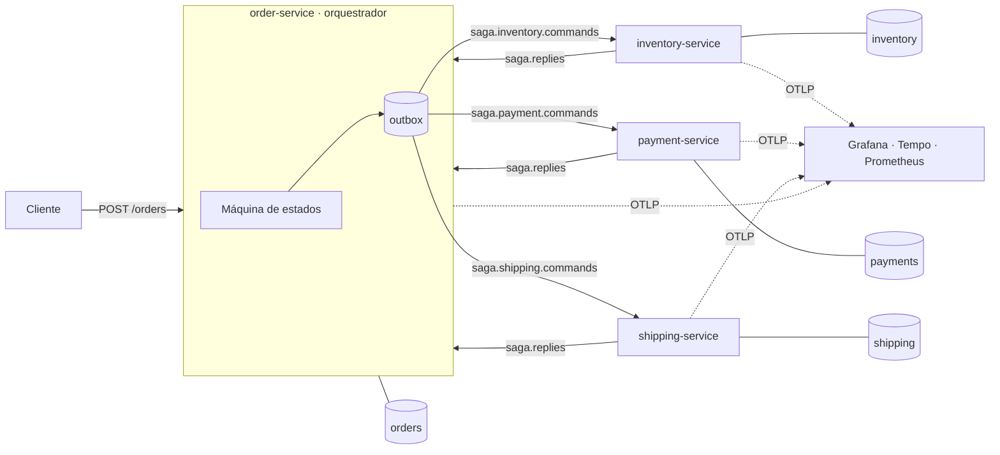
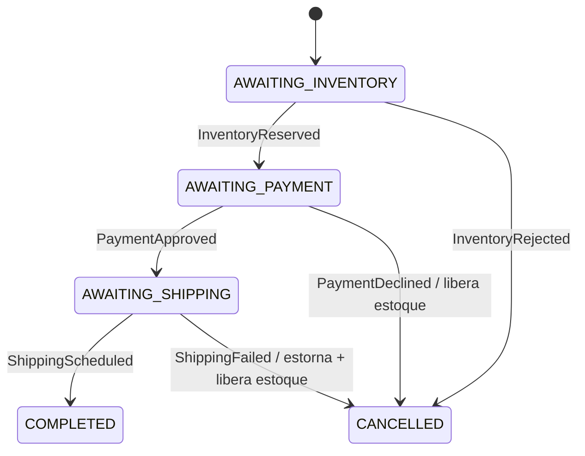

# Order Saga Microservices

[](https://github.com/efvieira/order-saga-microservices/actions/workflows/ci.yml)
[](https://github.com/efvieira/order-saga-microservices/actions/workflows/cd.yml)


[](LICENSE)

Fluxo de pedidos de um e-commerce dividido em **quatro microsserviços**. Eles conversam por eventos no Kafka e mantêm a consistência com uma **saga orquestrada**: pedido → estoque → pagamento → entrega. Se qualquer etapa falhar, as anteriores são **compensadas** (estoque liberado, pagamento estornado).

Tudo sobe com `docker compose`, com traces e métricas no **Grafana**. A infraestrutura AWS (ECS Fargate, MSK, RDS, ALB) está descrita em **Terraform**.

### ✨ Destaques

- 🎼 **Saga orquestrada** com máquina de estados explícita e compensações em ordem inversa
- 📤 **Transactional outbox** em todos os serviços: estado e mensagem confirmam juntos
- 📥 **Consumidores idempotentes** (inbox): mensagens duplicadas do Kafka não geram efeito duplicado
- 🗃️ **Banco por serviço**: nenhum serviço lê a tabela de outro
- 🔭 **OpenTelemetry**: traces e métricas exportados via OTLP para Grafana, Tempo e Prometheus
- ☁️ **Terraform** para AWS, validado no CI
- 🧵 **Java 25**: sealed interfaces e pattern matching com guardas (`case X x when ...`) modelando a saga

### 🛠️ Stack

Java 25 · Spring Boot 4.1 · Spring Kafka · Apache Kafka 4 (KRaft) · Spring Data JPA · Flyway · PostgreSQL · Micrometer + OpenTelemetry · Grafana LGTM · Terraform · AWS (ECS Fargate, MSK, RDS, ALB, ECR) · Docker · GitHub Actions

## 🏗️ Arquitetura



### Estados do pedido



## 🧠 Decisões técnicas

| Decisão | Por quê |
|---|---|
| Saga **orquestrada** (e não coreografada) | O fluxo inteiro fica legível num só lugar (`Order.handle`). Com quatro etapas e compensações, a coreografia espalharia a regra pelos serviços. |
| Outbox em todos os serviços | Sem ele, o serviço pode gravar no banco e cair antes de publicar a resposta, deixando a saga parada para sempre. |
| Inbox com o `messageId` | O Kafka entrega *at-least-once*. Gravar o id na mesma transação garante que reprocessar não debita estoque nem cobra duas vezes. |
| Compensações idempotentes | Liberar estoque ou estornar duas vezes não muda nada (reserva marcada como liberada, estorno só de pagamento aprovado). |
| Chave da mensagem = id do pedido | Preserva a ordem das mensagens de uma mesma saga dentro da partição. |
| Respostas fora de ordem são ignoradas | `handle` só aceita a resposta esperada para o estado atual (guardas no `switch`). |
| Contrato em `sealed interface` com records | Adicionar uma mensagem obriga a tratá-la em todos os `switch` exaustivos. |
| Um schema por serviço no RDS da AWS | Mantém o isolamento de dados com custo de uma instância só no ambiente de demonstração. |

## 🚀 Como rodar

```bash
docker compose up -d --build
```

| Serviço | URL |
|---|---|
| Pedidos (API) | http://localhost:8081/orders |
| Estoque | http://localhost:8082/stock |
| Pagamentos | http://localhost:8083/payments/{orderId} |
| Entregas | http://localhost:8084/shipments/{orderId} |
| Grafana | http://localhost:3000 (Explore → Tempo) |

### Cenários para testar

```bash
# Sucesso: termina COMPLETED com código de rastreio
curl -s -X POST localhost:8081/orders -H 'Content-Type: application/json' -d '{
  "customerId": "cliente-1", "zipCode": "01310100",
  "lines": [{"sku": "MOUSE-SEM-FIO", "quantity": 1, "unitPrice": 99.90}]}'

# Sem estoque (TECLADO-MEC tem 0): CANCELLED sem compensação
# Pagamento recusado (valor acima de 5000): CANCELLED e estoque liberado
# Entrega fora da área (CEP começando com 69): CANCELLED, pagamento estornado e estoque liberado

curl -s localhost:8081/orders/<id>
```

### Testes

```bash
./mvnw verify
```

## ☁️ Infraestrutura AWS (Terraform)

`infra/terraform` cria a VPC (subnets públicas e privadas, NAT), o ECR para cada serviço, o cluster ECS Fargate com um serviço por microsserviço, o MSK (Kafka gerenciado), o RDS PostgreSQL com a senha no Secrets Manager e o ALB expondo só a API de pedidos.

```bash
cd infra/terraform
terraform init
terraform plan
```

> O CI roda `terraform fmt` e `terraform validate`, mas não aplica nada. Os recursos têm custo (MSK, NAT e RDS); destrua com `terraform destroy` depois de testar.

## 🗺️ Próximos passos

- [ ] Propagar o `traceparent` pelo outbox, para que a saga inteira apareça num único trace (hoje cada salto pelo outbox abre um trace novo)
- [ ] Testcontainers com Kafka real nos testes de integração
- [ ] Timeout da saga: pedidos parados num estado por muito tempo disparam compensação
- [ ] Dead letter topic para mensagens que não desserializam
- [ ] Coletor ADOT na AWS para enviar traces ao X-Ray ou Grafana Cloud

## 🔀 Fluxo de branches e CI/CD

`develop` (padrão) → `release` → `master`, sempre por PR. Detalhes em [CONTRIBUTING.md](CONTRIBUTING.md).

- **CI**: build e testes de todos os módulos com Java 25, cobertura mínima por módulo e validação do Terraform.
- **CD**: uma imagem por serviço no GHCR (`:rc` em `release`, `:latest` em `master`) e release no GitHub.

## 📄 Licença

[MIT](LICENSE)
